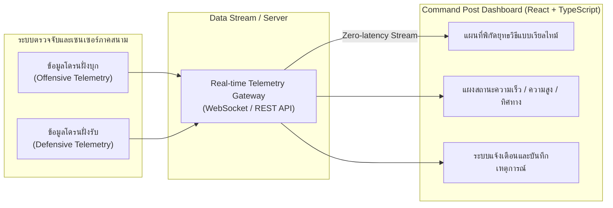

# Command Post Visualization Dashboard — ระบบแดชบอร์ดศูนย์บัญชาการติดตามและจำลองสถานะโดรนแบบเรียลไทม์

> 🏆 **รางวัลที่ได้รับ:** **Winner — Top Score Command Post Visualization** จากการแข่งขันระบบสมองกลฝังตัวชิงแชมป์ประเทศไทย **TESA Top Gun Rally 2025**  
> **บทบาทในทีม (Role):** Frontend Developer (Command Post Visualization)

**Command Post Visualization Dashboard** คือเว็บแอปพลิเคชันแดชบอร์ดสำหรับศูนย์บัญชาการ (Command Post) ที่พัฒนาขึ้นในการแข่งขัน **TESA Top Gun Rally 2025** เพื่อรับข้อมูลสตรีมมิงแบบเรียลไทม์และแสดงผลพิกัด ทิศทางการเคลื่อนที่ และสถานะของโดรนทั้ง **ฝั่งบุก (Offensive Drone)** และ **ฝั่งรับ/ป้องกัน (Defensive Drone)** ด้วยความหน่วงต่ำ (Zero-latency Data Stream Visualization) ช่วยให้ทีมควบคุมสามารถวิเคราะห์สถานการณ์และตัดสินใจเชิงยุทธวิธีได้อย่างแม่นยำและทันท่วงที

---

## จุดเด่นของระบบ (Key Features)

- **Real-time Offensive & Defensive Drone Tracking**:
  - แสดงตำแหน่งพิกัดละติจูด/ลองจิจูด ความสูง ความเร็ว และทิศทางการบินของโดรนทั้งฝั่งบุกและฝั่งตั้งรับบนแผนที่ยุทธวิธีแบบเรียลไทม์
  - แยกสีและสัญลักษณ์สถานะอย่างชัดเจนเพื่อง่ายต่อการประเมินสถานการณ์ในภาวะคับขัน
- **Zero-Latency Data Stream Visualization**:
  - ออกแบบโครงสร้างการรับและอัปเดตสถานะบนหน้าจอ React & TypeScript ให้รองรับข้อมูลความถี่สูงจากระบบตรวจจับและเซนเซอร์ภาคสนามโดยไม่เกิดอาการหน้าจอกระตุก
- **Tactical Alert & Decision Support Panel**:
  - แสดงโซนเฝ้าระวัง ระยะห่างการสกัดกั้น ประวัติการตรวจจับ (Detection Logs) และสถานะความพร้อมของระบบสื่อสาร เพื่อช่วยประกอบการตัดสินใจของศูนย์บัญชาการ

---

## เทคโนโลยีที่ใช้ (Tech Stack)

- **Frontend Framework**: React, TypeScript, Vite
- **Styling & UI Components**: Tailwind CSS, Modern Dashboard UI
- **Real-time Communication & Data Visualization**: WebSockets / Real-time Telemetry Stream, Map & Tactical Overlay Visualization

---

## สถาปัตยกรรมและการไหลของข้อมูล (System Workflow)



---

## โครงสร้างโปรเจค (Project Structure)

```text
drone-dashboard/
├── public/                  # ไฟล์ Static Assets และไอคอนยุทธวิธี
├── src/
│   ├── components/          # คอมโพเนนต์แผนที่, แผงสถานะโดรนฝั่งบุก/ฝั่งรับ, ระบบแจ้งเตือน
│   ├── hooks/               # Custom Hooks สำหรับเชื่อมต่อข้อมูลสตรีมมิงแบบเรียลไทม์
│   ├── types/               # TypeScript Interfaces สำหรับข้อมูลพิกัดและสถานะโดรน
│   ├── App.tsx              # หน้าจอหลักของ Command Post Dashboard
│   └── main.tsx             # จุดเริ่มต้นของแอปพลิเคชัน
├── .gitignore               # รายการไฟล์ที่ยกเว้นจาก Git
└── README.md                # เอกสารอธิบายโปรเจค
```

---

## การติดตั้งและรันโปรเจคในเครื่อง (Getting Started)

### 1. โคลนโปรเจคและติดตั้งแพ็กเกจ
```bash
git clone https://github.com/Piano-sf/drone-dashboard.git
cd drone-dashboard
npm install
```

### 2. เริ่มรันเซิร์ฟเวอร์สำหรับพัฒนา
```bash
npm run dev
```

### 3. การ Build สำหรับใช้งานจริง
```bash
npm run build
npm run preview
```
