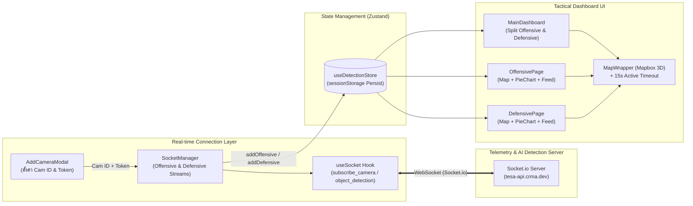

# Drone Telemetry & Object Detection Dashboard — ระบบแดชบอร์ดติดตามและแสดงผลพิกัดโดรนแบบเรียลไทม์

> 🏆 **ผลงานรางวัลชนะเลิศอันดับ 1 (1st Place Winner)** — การแข่งขัน **TESA Top Gun Rally 2025**  
> **ขอบเขตระบบ:** Real-time Tactical Drone & Object Detection Dashboard (React 19 + TypeScript + Mapbox GL 3D + Socket.io + Zustand)

**Drone Dashboard** คือระบบเว็บแอปพลิเคชันสำหรับเฝ้าระวัง ติดตามพิกัด และแสดงผลการตรวจจับวัตถุและอากาศยานไร้คนขับ (UAV / Drone Detection) แบบเรียลไทม์ พัฒนาขึ้นในการแข่งขัน **TESA Top Gun Rally 2025** โดยทำหน้าที่รับสตรีมข้อมูลการตรวจจับ (`object_detection`) จากกล้องตรวจการณ์ทั้งฝั่งรุก (**Offensive**) และฝั่งรับ (**Defensive**) ผ่าน `Socket.io` แล้วนำมาแสดงผลบนแผนที่ดาวเทียม 3 มิติ (**Mapbox GL JS**) พร้อมระบบแจ้งเตือนและสถิติสถานะโดรนแบบสด

---

## จุดเด่นของระบบ (Key Features)

- **หน้าจอควบคุมแบบ Dual Tactical Map (`MainDashboard`)**:
  - แสดงแผนที่ดาวเทียมและฟีดการตรวจจับแยก 2 ฝั่งพร้อมกัน คือ **Offensive Map & Feed** (โทนสีแดง `#E74C3C`) และ **Defensive Map & Feed** (โทนสีน้ำเงิน `#3498DB`)
  - รองรับการกรองประเภทวัตถุที่ตรวจจับ (`GlobalFilterBar` เช่น `drone`, `person` หรือทั้งหมด) พร้อมนาฬิกาเวลาจริง (`LiveClock`) และไฟสถานะการเชื่อมต่อ Socket แยกตามฝั่ง
- **แผนที่ดาวเทียม 3 มิติและระบบจัดการ Marker อัตโนมัติ (`MapWrapper`)**:
  - ขับเคลื่อนด้วย **Mapbox GL JS** (`satellite-streets-v12`) พร้อมชั้นข้อมูลภูมิประเทศ 3 มิติ (`mapbox-terrain-dem-v1C`, Exaggeration `1.5x`) และชั้นบรรยากาศ (`sky` layer)
  - **15-Second Active Marker Timeout**: คำนวณอายุของสัญญาณตรวจจับอัตโนมัติ (`MARKER_TIMEOUT_MS = 15000`) โดยแสดงเฉพาะวัตถุที่ยังเคลื่อนไหวอยู่ในช่วง 15 วินาทีล่าสุดบนแผนที่ และแยกสถานะระหว่าง **Active** กับ **Lost**
  - รองรับคำสั่ง **Fly-to-Map (`flyTo`)** ซูมไปยังพิกัดเป้าหมายที่ระดับความลึก `Zoom 18` ทันทีเมื่อคลิกเลือกโดรนจากรายการหรือจากหน้าต่างภาพถ่าย
- **มุมมองยุทธวิธีเชิงลึกแยกฝั่ง (`OffensivePage` & `DefensivePage`)**:
  - แสดงกราฟวงกลมสรุปสัดส่วนสัญญาณ **Active vs Lost** แบบเรียลไทม์ (`StatsPieChart` ด้วย `Chart.js`)
  - มีเมนู `DroneListDropdown` สำหรับเลือกกระโดดไปยังพิกัดโดรนแต่ละลำที่กำลังออนไลน์ พร้อมแสดงพิกัดปัจจุบัน (`LocationDisplay`)
- **ระบบเชื่อมต่อกล้องแบบไดนามิกและดูภาพหลักฐาน (`SocketManager` & `ImageModal`)**:
  - ตั้งค่า `Camera ID` และ `Token` ของกล้องฝั่ง Offensive และ Defensive ได้โดยตรงผ่านหน้าเว็บ (`AddCameraModal`) เพื่อส่งคำสั่ง `subscribe_camera` ไปยังเซิร์ฟเวอร์สตรีมมิง
  - คลิกที่ Marker บนแผนที่หรือรายการใน `DetectionFeed` เพื่อเปิด `ImageModal` ดูภาพถ่ายจากกล้องตรวจการณ์ เวลาที่ตรวจพบ พิกัด `Lat/Lng` และปุ่มนำทางไปยังตำแหน่งบนแผนที่

---

## เทคโนโลยีที่ใช้ (Tech Stack)

| หมวดหมู่ | เทคโนโลยี / ไลบรารี |
| :--- | :--- |
| **Frontend Framework** | React 19 (`^19.2.0`), TypeScript (`~5.9.3`), Vite (`rolldown-vite@7.2.2`), React Router v7 |
| **3D Geospatial Map** | Mapbox GL JS (`mapbox-gl@^3.16.0` — Satellite Streets v12 & 3D Terrain DEM) |
| **Real-time & State** | Socket.io Client (`socket.io-client@^4.8.1`), Zustand (`zustand@^5.0.8` พร้อม `sessionStorage` Persist) |
| **Data Visualization** | Chart.js (`chart.js`, `react-chartjs-2`), Apache ECharts (`echarts@^6.0.0`, `echarts-for-react`) |
| **Styling & Icons** | CSS Modules (`*.module.css`), Styled Components (`styled-components`), Iconify (`@iconify/react`) |

---

## สถาปัตยกรรมและการไหลของข้อมูล (System Architecture)



---

## โครงสร้างโปรเจค (Project Structure)

```text
drone-dashboard/
├── src/
│   ├── components/
│   │   ├── common/
│   │   │   ├── SocketManager.tsx        # ตัวจัดการเชื่อมต่อ Socket.io ทั้งฝั่ง Offensive และ Defensive
│   │   │   ├── StatsPieChart.tsx        # กราฟวงกลมแสดงสัดส่วนสัญญาณ Active vs Lost
│   │   │   ├── DroneListDropdown.tsx    # เมนูดรอปดาวน์เลือกโดรนเพื่อซูมไปยังพิกัดบนแผนที่
│   │   │   ├── ImageModal.tsx           # หน้าต่างแสดงภาพถ่ายวัตถุที่ตรวจพบและปุ่ม Fly to Map
│   │   │   ├── LiveClock.tsx            # นาฬิกาแสดงเวลาปัจจุบันแบบเรียลไทม์
│   │   │   └── LocationDisplay.tsx      # แถบแสดงพิกัดภูมิศาสตร์
│   │   ├── feed/
│   │   │   ├── DetectionFeed.tsx        # รายการแจ้งเตือนการตรวจจับแบบเรียลไทม์
│   │   │   └── DetectionFeedItem.tsx    # การ์ดแสดงรายละเอียดของแต่ละเหตุการณ์ที่ตรวจพบ
│   │   ├── filters/
│   │   │   └── GlobalFilterBar.tsx      # ตัวกรองประเภทวัตถุ (All / Drone / Person)
│   │   ├── forms/
│   │   │   └── AddCameraModal.tsx       # ฟอร์มตั้งค่า Camera ID และ Token สำหรับเชื่อมต่อกล้อง
│   │   ├── layout/
│   │   │   ├── Layout.tsx               # โครงสร้างหน้าเว็บหลัก
│   │   │   └── Sidebar.tsx              # แถบเมนูนำทางและปุ่มตั้งค่ากล้อง/ล้างข้อมูล
│   │   ├── map/
│   │   │   ├── MapWrapper.tsx           # คอมโพเนนต์แผนที่ Mapbox GL 3D + ระบบจัดการ Marker & Popup
│   │   │   ├── CustomMarker.tsx         # ไอคอนหมุดวัตถุบนแผนที่แยกสีตามฝั่ง (Offence/Defence)
│   │   │   └── DetectionPopup.tsx       # ป๊อปอัปแสดงข้อมูลวัตถุและพิกัดบนแผนที่
│   │   ├── pages/
│   │   │   ├── MainDashboard.tsx        # หน้าแดชบอร์ดหลัก (แสดงแผนที่และฟีดทั้ง 2 ฝั่งพร้อมกัน)
│   │   │   ├── OffensivePage.tsx        # หน้ามุมมองฝั่งรุก (Offensive Map, Statistics & Feed)
│   │   │   ├── DefensivePage.tsx        # หน้ามุมมองฝั่งรับ (Defensive Map, Statistics & Feed)
│   │   │   └── SimulatorPage.tsx        # หน้าสำหรับทดสอบจำลองข้อมูล
│   │   └── types/
│   │       └── Detection.ts             # โครงสร้างข้อมูล TypeScript ของ DetectionEvent และ DetectedObject
│   ├── data/
│   │   └── mockEvents.ts                # ข้อมูลจำลองสำหรับการทดสอบแสดงผล
│   ├── hooks/
│   │   └── useSocket.ts                 # Custom Hook เชื่อมต่อ Socket.io และรับอีเวนต์ object_detection
│   ├── store/
│   │   └── detectionStore.ts            # Zustand Store จัดเก็บประวัติการตรวจจับและสถานะการเชื่อมต่อ
│   ├── App.tsx                          # ตั้งค่า React Router (/, /offensive, /defensive)
│   └── main.tsx                         # จุดเริ่มต้นของแอปพลิเคชัน React
├── package.json
├── tsconfig.json
└── vite.config.ts
```

---

## การติดตั้งและรันโปรเจคในเครื่อง (Getting Started)

### สิ่งที่ต้องเตรียมล่วงหน้า (Prerequisites)
- **Node.js** (เวอร์ชัน 18 ขึ้นไป)
- **Mapbox Access Token** สำหรับแสดงผลแผนที่ดาวเทียม 3 มิติ

### 1. โคลนโปรเจคและติดตั้งแพ็กเกจ
```bash
git clone https://github.com/Piano-sf/drone-dashboard.git
cd drone-dashboard
npm install
```

### 2. ตั้งค่า Environment Variables
สร้างไฟล์ `.env` ที่โฟลเดอร์รากของโปรเจค และระบุค่า Mapbox Access Token:
```env
VITE_MAPBOX_TOKEN=pk.eyJ1IjoieW91ci11c2VybmFtZSIsImEiOiJ5b3VyLW1hcGJveC10b2tlbiJ9...
```

### 3. รันเซิร์ฟเวอร์สำหรับพัฒนา (Development Server)
```bash
npm run dev
```
เปิดเบราว์เซอร์ไปที่ `http://localhost:5173` (สามารถตั้งค่า `Camera ID` และ `Token` ของกล้องแต่ละฝั่งได้ที่เมนู Sidebar ด้านซ้าย)

### 4. การ Build สำหรับใช้งานจริง (Production Build)
```bash
npm run build
npm run preview
```

---

## ผู้พัฒนา (Author)

- **สวิตตา ฟุ้งลัดดา (Sawitta Fungladda)** — [@Piano-sf](https://github.com/Piano-sf) | [Portfolio](https://piano-sf.github.io/Portfolio/)
